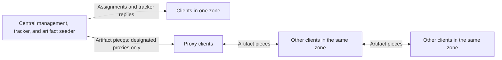

# BootTorrent architecture and intended zone policy

Testbed update, 6 October 2026: the ten planned physical clients will be installed with Linux. The [deployment kit](../../lab-deployment/) records the initial setup; older Windows references on this page describe the prior plan.

This page describes the **target behavior**. It is not a claim that every path works in the current checkout; see [the repository README](../Readme.md) for observed implementation gaps and [the evaluation plan](../../Evaluation-Setup.md) for verification steps.

## Why zones matter

The motivating school has many computer labs. Most rooms have about 36 clients, and two have up to 80. A client normally has a 1 Gbit/s Ethernet link to the room's switch. A lab typically uses a 2 × 10 Gbit/s LACP fibre uplink, while the switch can forward much more aggregate local traffic. Each lab normally has its own VLAN confined to its room switch. A multi-switch large room uses high-throughput stacking links and can be treated as one local zone for this design. These values describe the motivating installation, not the smaller ten-client thesis testbed.

If every client obtains a large artifact from the central server, the data traverses the room uplink repeatedly. Zone-local BitTorrent exchange lets the room use otherwise idle switch capacity. The expected benefit is lower origin and uplink traffic; completion time and actual traffic paths must be measured rather than assumed.

## Roles and paths

The server may combine management, tracker, and seeder roles on one host, but their responsibilities differ. MQTT handles registration, assignments, and status. The tracker supplies peer addresses. BitTorrent connections carry pieces. A **proxy** is a normal client granted permission to obtain pieces directly from the central seeder. It is not a forwarding gateway or the only uploader. A designated proxy can also receive pieces from zone peers; ordinary peers may upload to proxies and to one another.

The normal zone-aware policy returns only same-zone client peers to ordinary clients and same-zone peers plus the central seeder to designated proxies. It never gives an ordinary client a central-seeder fallback. If no suitable peer is available, an ordinary client waits or retries discovery. A request that cannot be mapped to exactly one zone should fail closed in zone-aware mode rather than silently use unrestricted peer selection. Peer exchange and cached addresses must not bypass these rules.

## Assignment and availability

1. Management assigns an artifact to a zone. Online targets receive the assignment, and the zone's assignment state remains available for targets that are offline.
2. Management designates a configurable small number of available zone clients as proxies for initial acquisition. Proxies can obtain origin pieces; every participating zone client can exchange local pieces as they become available.
3. If every proxy becomes unavailable **and no available, verified complete copy exists in the zone**, management designates another available client as a proxy and grants origin access to that client. If no candidate is online, acquisition waits. Ordinary clients do not gain origin access by default.
4. When an initially offline client reconnects, management gives it the outstanding zone assignment. If an available zone peer already has a verified complete artifact, the returning client gets all artifact payload from zone peers. That acquisition needs **zero additional central-origin artifact payload**, although MQTT, tracker, and other control traffic may still reach the server.

Proxy count per zone is the main policy parameter. Stable designations are preferable to frequent timer-based rotation. Low load and long uptime are plausible candidate signals, not implemented or validated selection rules. A complete local copy matters for the recovery decision; peers with partial copies can still contribute useful pieces during transfer.

## Zone boundaries and evaluation

Normal distribution keeps artifact peers within their zone. Cross-zone sharing could be a separate policy if the objective is to reduce central origin load when a zone lacks data, but it is not the intended default. An unrestricted mode may be used as an experimental comparator and can take cross-zone paths.

The planned thesis testbed uses ten Windows laptops, one CachyOS server, and a Cisco Catalyst 3560G. All three research-question campaigns use **one zone**; RQ1 selects subsets of four, six and ten clients from that zone. A separate two-zone tracker check may test logical isolation, but it is not a performance campaign. The testbed's VLANs, links, and measured rates must be recorded separately from the motivating school network. Tracker responses indicate allowed discovery, not the bytes actually transferred; endpoint captures and source measurements are needed to establish the realized data paths.
